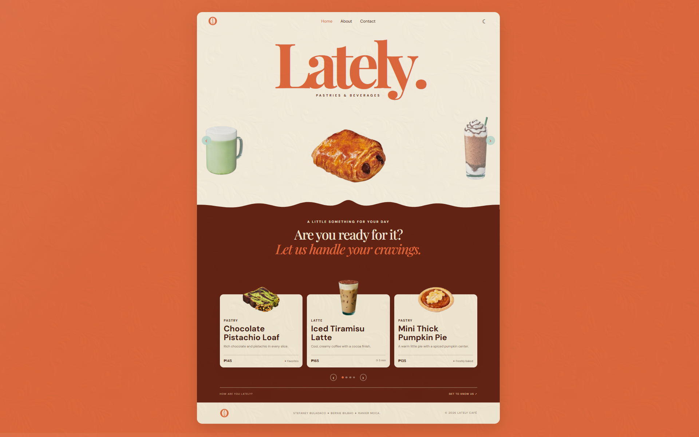
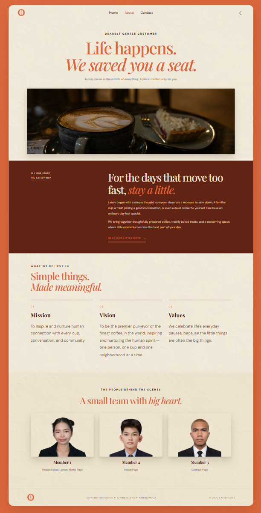
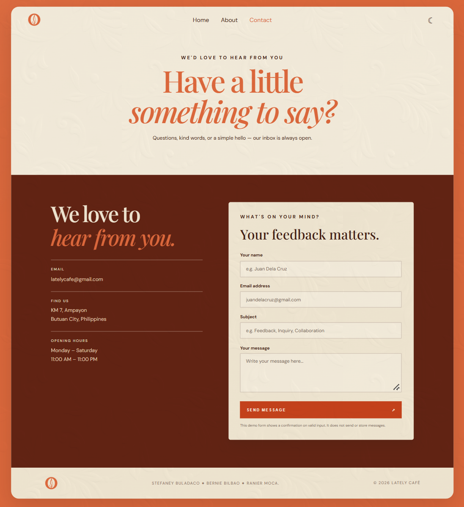

# Group Information

Group Name | Team Lately
Section | IT 110 - AIBJ2
Repository | Lara-Proj-IT110AIBJ2-Buladaco-Bilbao-Moca |

# Members

1. Stefaney Buladaco (Member 1)
2. Bernie Bilbao (Member 2)
3. Ranier Moca ((Member 3))

# Theme

A multi-page Laravel web application for **Lately Café**, a cozy café serving pastries and beverages for people who want to slow down: coffee, freshly baked pastries, and a warm place to sit.

# Modules and Branches

| Member | Module | Branch | JavaScript feature
| Stefaney Buladaco (Member 1, Leader) | Project setup, master layout, Home page | `dev-member1-Buladaco` | Image carousel and dark/light mode toggle
| Bernie Bilbao (Member 2) | About page | `dev-member2-Bilbao` | "Read more / Read less" toggle
| Ranier Moca (Member 3) | Contact page | `dev-member3-Moca` | Client-side form validation with success message

# Screenshots

## Home page



## About page



## Contact page



# Steps to Run the Project

## Prerequisites

Before running the project, make sure you have installed the following:

- PHP 8.3 or higher
- Composer
- Laravel-compatible PHP extensions
- Git
- A code editor (VS Code recommended)

## 1. Clone the Repository

Open your terminal and run:

```bash
git clone https://github.com/stefaney-tech/Lara-Proj-IT110AIBJ2-Buladaco-Bilbao-Moca.git
```

## 2. Navigate to the Project Folder

```bash
cd Lara-Proj-IT110AIBJ2-Buladaco-Bilbao-Moca
```

## 3. Install Dependencies

Install the required PHP packages using Composer:

```bash
composer install
```

## 4. Create the Environment File

Copy the example environment file:

**Windows:**

```bash
copy .env.example .env
```

**macOS / Linux:**

```bash
cp .env.example .env
```

## 5. Generate the Application Key

```bash
php artisan key:generate
```

## 6. Configure the Database

Open the `.env` file and configure the database settings according to your local environment.
For a default SQLite setup, make sure the SQLite database file exists and the database connection is configured correctly.

## 7. Run Database Migrations

```bash
php artisan migrate
```

## 8. Start the Laravel Development Server

```bash
php artisan serve
```

## 9. Open the Website

Open your browser and visit:
http://127.0.0.1:8000

The Lately Café website should now be running locally.

---

**Note:** Do not commit or upload your `.env` file or `vendor` folder to the GitHub repository. These are generated or locally configured during project setup.
